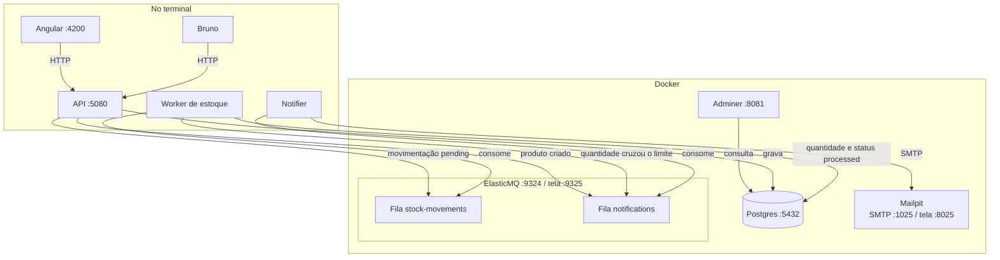
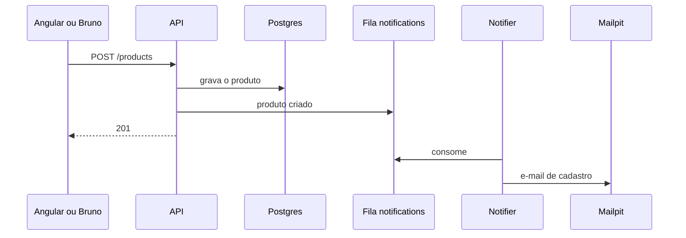
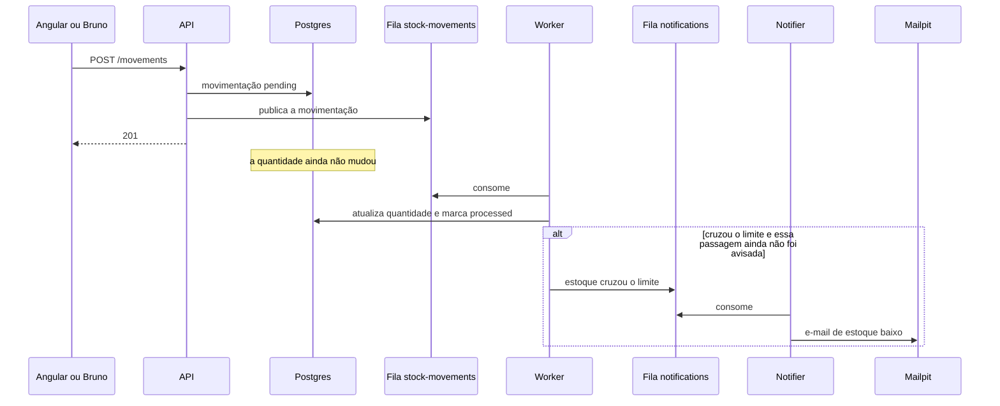

# estoque-lab

Laboratório local de controle de estoque. A página chama a API, a API grava no banco e publica um fato numa fila. Outro processo consome esse fato e só então muda a quantidade. Um terceiro processo avisa por e-mail quando um produto nasce ou quando o estoque fica baixo.

O volume é de teste. Nada aqui usa conta da AWS nem gera custo. O repositório ainda não tem código: este arquivo é o plano funcional e técnico. A construção segue a sequência da seção [Plano de ação](#plano-de-ação), um passo por vez.

## Objetivo

Percorrer o caminho inteiro de uma aplicação que separa três trabalhos:

1. Receber o pedido HTTP e gravar o que aconteceu.
2. Aplicar o efeito no estoque, fora do pedido HTTP.
3. Avisar uma pessoa, também fora do pedido HTTP.

A fila é o meio desses dois últimos trabalhos. O canal de aviso deste lab é e-mail visto numa tela local. O desenho é o mesmo de um aviso por outro canal: muda o entregador, não a fila.

## Escopo

- Cadastro de produto: listar, buscar por id, criar, substituir, alterar um campo e apagar.
- Movimentação de entrada e de saída, com status `pending` ou `processed`.
- Atualização da quantidade só depois que o worker consome a mensagem.
- Reprocessar a mesma mensagem não altera a quantidade de novo.
- Regra de estoque baixo por produto.
- E-mail local quando um produto é cadastrado.
- E-mail local quando a quantidade cruza o limite para baixo, uma vez por cruzamento.
- Collection HTTP versionada neste repositório, para exercitar a API sem o browser.

## Fora do escopo

- Login, usuário e permissão.
- Conta AWS, SQS real, SNS, Lambda ou qualquer recurso que possa cobrar.
- SMS, WhatsApp e push. Exigem provedor e, no SMS, cobram por mensagem.
- API, worker, notifier e Angular dentro do Docker.
- Vários destinatários. O aviso vai para um endereço só, configurado na aplicação.

## Quem usa

Uma pessoa no próprio computador. Não há conta. O Bruno e o Angular são dois clientes da mesma API.

## Regras de negócio

### Produto

Um produto tem SKU, nome, preço e quantidade. A quantidade inicial é definida no cadastro. Criar, substituir, alterar um campo ou apagar o produto não passa pela fila: a API grava e responde. O cadastro também publica o fato "produto criado", e o notifier manda o e-mail. A resposta HTTP não espera esse e-mail.

`PUT` substitui o produto pelo corpo enviado. `PATCH` altera só o campo enviado e mantém o resto. Essa diferença é o ponto desse passo da construção.

Apagar o produto faz o `GET` seguinte responder 404.

### Movimentação

Uma movimentação é entrada ou saída de uma quantidade de um produto. Ela nasce com status `pending`. Nesse momento a quantidade do produto continua a mesma.

O worker consome a mensagem, aplica a quantidade e marca a movimentação como `processed`, na mesma transação. Entrada soma. Saída subtrai. Se a mesma mensagem chegar de novo, o worker vê que já está `processed` e não soma nem subtrai outra vez.

A saída pode deixar a quantidade negativa neste lab. Não há reserva nem bloqueio de estoque.

### Alerta de estoque baixo

A regra guarda o produto e o limite. O exemplo guia é limite 10: avisar quando a quantidade fica em 10 ou menos.

O aviso não sai no `POST /movements`. Nesse instante a quantidade ainda não mudou. O worker avalia a regra depois de gravar a quantidade nova.

O cruzamento é a passagem de acima do limite para o limite ou menos. Ficar abaixo não gera outro e-mail. A quantidade voltar para cima do limite arma a regra de novo. O próximo cruzamento gera outro e-mail.

O worker publica o fato. O notifier entrega. Falha no e-mail não desfaz a movimentação.

## Arquitetura

Angular, Bruno, API, worker e notifier rodam no terminal, para dar para depurar. Postgres, Adminer, ElasticMQ e Mailpit rodam no Docker.

### Cadastro de produto

### Entrada ou saída

## Componentes

### Angular

Cliente web em `localhost:4200`. Primeiro só lista os produtos. Depois ganha formulários para criar, substituir (`PUT`), alterar um campo (`PATCH`) e apagar. Por último, o formulário de entrada e saída.

O browser em `localhost:4200` chama a API em `localhost:5080`. Isso é outra origem, então a API precisa liberar CORS para essa origem. O Bruno não passa por essa regra: ele não é um browser.

### Bruno

Cliente HTTP usado antes do Angular existir. A collection fica versionada em `bruno/`. Cada request guarda método, URL, status esperado e body. É o lugar para ver 200, 201 e 404 sem tela.

### API

ASP.NET Core em `localhost:5080`. É o único processo que recebe HTTP do Angular e do Bruno.

Ela grava produto, movimentação `pending` e regra de alerta. Publica mensagem na fila de estoque ao criar movimentação, e na fila de notificações ao criar produto. Não altera a quantidade por causa de uma movimentação e não envia e-mail.

`GET /health` existe para provar que o processo subiu, antes de existir produto.

### Worker de estoque

Processo separado, `BackgroundService`, no terminal. Faz long polling na fila `stock-movements`, apontando o SDK da AWS para o ElasticMQ em `localhost:9324`.

Para cada mensagem, abre uma transação: lê a movimentação, aplica a quantidade se o status ainda é `pending`, marca `processed` e avalia a regra de alerta. Se houve cruzamento, publica na fila `notifications` depois do commit da quantidade. Mensagem de movimentação já `processed` é ignorada e removida da fila.

### Notifier

Outro `BackgroundService`, no terminal. Consome só a fila `notifications` e envia o e-mail ao Mailpit por SMTP.

Fica separado do worker de estoque de propósito. E-mail lento ou SMTP parado não segura a atualização da quantidade. Uma mensagem de notificação repetida não gera segundo e-mail: o notifier registra o id da mensagem que já enviou.

O destinatário é um endereço único, lido da configuração. Em exemplo, use um placeholder como `estoque@localhost`.

### Postgres 16

Banco relacional no Docker, porta `5432` na máquina. Os dados ficam num volume, então somem só se o volume for apagado, não quando o container para.

Tabelas previstas:

| Tabela | Papel | Campos |
| --- | --- | --- |
| `products` | O item em estoque | SKU, nome, preço, quantidade |
| `stock_movements` | O pedido de entrada ou saída | produto (chave estrangeira), tipo entrada ou saída, quantidade, status `pending` ou `processed` |
| `stock_alert_rules` | O limite que dispara o aviso | produto (chave estrangeira), limite, se a regra está armada para o próximo cruzamento |
| `notification_log` | O que o notifier já enviou | id da mensagem, tipo do aviso, quando enviou |

As tabelas nascem por migration do EF Core, não por script solto no Adminer. `stock_alert_rules` e `notification_log` entram junto com a parte de notificação, depois do fluxo de estoque já funcionar.

### Adminer

Cliente web do banco, no Docker, porta `8081`. Serve para ver o banco vazio, a tabela criada pela migration, a linha do `POST` e a quantidade mudando só depois do worker. DBeaver no desktop é opcional e não faz parte do compose.

### ElasticMQ

Fila compatível com o protocolo do SQS, no Docker. A API do protocolo fica na porta `9324`. A tela fica na porta `9325`.

Não é endpoint para o usuário. O Angular não chama a fila. Duas filas no mesmo processo:

| Fila | Quem publica | Quem consome | Mensagem |
| --- | --- | --- | --- |
| `stock-movements` | API, no `POST /movements` | Worker de estoque | Id da movimentação |
| `notifications` | API, no `POST /products`; worker, quando a quantidade cruza o limite | Notifier | Tipo do aviso, id do produto e, no estoque baixo, quantidade e limite |

A tela do ElasticMQ é a prova de que a mensagem ficou parada quando o consumidor ainda não existe. Trocar para um SQS real, fora deste lab, seria URL, região e credencial. O código continua usando o SDK da AWS.

### Mailpit

Servidor SMTP local no Docker, com tela no navegador. Recebe o e-mail do notifier e mostra o conteúdo. Porta SMTP `1025`. Tela `8025`.

Não entrega na internet. É a prova visível do aviso, no mesmo papel que a tela do ElasticMQ tem para a fila.

## Contratos HTTP

Base da API: `http://localhost:5080`.

| Método e caminho | Efeito | Resposta que o lab confere |
| --- | --- | --- |
| `GET /health` | Processo no ar | 200 |
| `GET /products` | Lista. No início, vazia | 200 e lista |
| `GET /products/{id}` | Um produto. Id ausente não é erro de servidor | 200, ou 404 |
| `POST /products` | Grava o produto e publica "produto criado" | 201 e a linha no Adminer |
| `PUT /products/{id}` | Substitui o produto pelo corpo | 200 |
| `PATCH /products/{id}` | Altera só o campo enviado | 200 |
| `DELETE /products/{id}` | Remove. O `GET` seguinte é 404 | 204, depois 404 |
| `POST /movements` | Grava `pending` e publica em `stock-movements`. A quantidade não muda | 201, mensagem na tela do ElasticMQ, quantidade igual no Adminer |
| `GET /movements` | Lista as movimentações e o status | 200 |
| `POST /stock-alert-rules` | Grava o limite de um produto | 201 e a linha no Adminer |
| `GET /stock-alert-rules` | Lista as regras | 200 |

Os corpos dos requests entram na collection do Bruno no passo em que o endpoint nasce. Este plano fixa o verbo, o caminho e o efeito, não o JSON de cada um.

## O que sobe onde

| Processo | Onde | Porta na máquina |
| --- | --- | --- |
| Angular | Terminal | 4200 |
| API | Terminal | 5080 |
| Worker de estoque | Terminal | nenhuma porta HTTP |
| Notifier | Terminal | nenhuma porta HTTP |
| Postgres 16 | Docker | 5432 |
| Adminer | Docker | 8081 |
| ElasticMQ, protocolo | Docker | 9324 |
| ElasticMQ, tela | Docker | 9325 |
| Mailpit, SMTP | Docker | 1025 |
| Mailpit, tela | Docker | 8025 |
| Bruno | Aplicativo no desktop | nenhuma |

## Ordem prevista para subir

Quando os projetos existirem, a ordem é esta. Subir fora dela faz a API falhar ao falar com o banco, ou o worker ficar sem fila.

1. Docker Desktop em execução.
2. Compose: Postgres, Adminer, ElasticMQ e Mailpit.
3. Migration: `dotnet ef database update` na API.
4. API na porta 5080.
5. Worker de estoque.
6. Notifier.
7. Angular na porta 4200.

O Bruno abre a collection `bruno/` quando for a hora de chamar a API.

## Plano de ação

Cada passo termina com uma prova visível. Sem essa prova, o passo não acabou. Se faltar Docker, .NET SDK, Node.js ou Bruno, a construção para na instalação.

| Passo | O que fazer | Prova |
| --- | --- | --- |
| 1 | Conferir `docker`, `dotnet`, `node` e o Bruno instalado | Versão de cada um no terminal, Docker Desktop em execução |
| 2 | Compose só com o Postgres 16 na porta 5432. Ver imagem, container, porta e volume | Porta 5432 aceitando conexão |
| 3 | Adminer na porta 8081 | Entrar e ver um banco sem tabelas |
| 4 | Solution e Web API com `GET /health` na porta 5080 | Resposta 200 |
| 5 | Primeira request no Bruno, collection em `bruno/` | Método, URL, status e body visíveis na collection |
| 6 | EF Core, entidade Product, DbContext, primeira migration, `dotnet ef database update` | Tabela `products` no Adminer |
| 7 | `GET /products` | 200 e lista vazia |
| 8 | `POST /products` | Linha no Adminer e a mesma linha num segundo GET |
| 9 | `GET /products/{id}` | 200 para id existente e 404 para id ausente |
| 10 | `PUT` substitui o produto. `PATCH` muda só um campo | Os dois efeitos conferidos no Adminer |
| 11 | `DELETE` | O GET seguinte responde 404 |
| 12 | Angular que só lista os produtos, com CORS | Lista vinda de `localhost:5080` aberta em `localhost:4200` |
| 13 | Formulários de criar, substituir, editar um campo e apagar | Os quatro verbos, já vistos no Bruno, disparados pela tela |
| 14 | Tabela `stock_movements` e `POST`/`GET /movements`, ainda sem fila | Linha `pending` no Adminer e quantidade do produto igual |
| 15 | ElasticMQ no compose | Tela na porta 9325, sem fila exposta ao browser da aplicação |
| 16 | `POST /movements` publica em `stock-movements`. Worker ainda não existe | Mensagem parada na tela do ElasticMQ e quantidade igual |
| 17 | Worker: long polling, transação, status `processed`, ignorar mensagem já processada | Quantidade muda uma vez; a segunda entrega da mesma mensagem não muda de novo |
| 18 | Formulário Angular de entrada e saída | Quantidade no Adminer muda só depois do worker |
| 19 | Mailpit no compose e fila `notifications` | Tela do Mailpit na porta 8025, ainda sem e-mail |
| 20 | Notifier consome `notifications` e envia ao Mailpit. `POST /products` publica "produto criado" | E-mail de cadastro na tela do Mailpit, com a API já tendo respondido 201 |
| 21 | Tabela `stock_alert_rules`, `POST`/`GET /stock-alert-rules`. O worker publica quando a quantidade cruza o limite | E-mail de estoque baixo uma vez; continuar abaixo não manda outro; voltar acima do limite e cruzar de novo manda outro |
| 22 | Revisar este README contra o que realmente subiu | Ordem de subir e o caminho da movimentação conferidos no computador |

## Pré-requisitos

- macOS Apple Silicon.
- Docker Desktop em execução, com `docker compose`.
- .NET SDK no canal LTS.
- Node.js LTS, para o Angular.
- Bruno.

## Estado atual

Repositório criado, clonado e aberto no Cursor. Ferramentas do passo 1 ainda não conferidas nesta máquina. Nenhum compose, projeto ou collection existe ainda.
